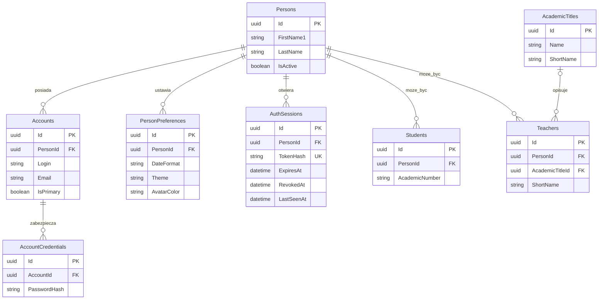
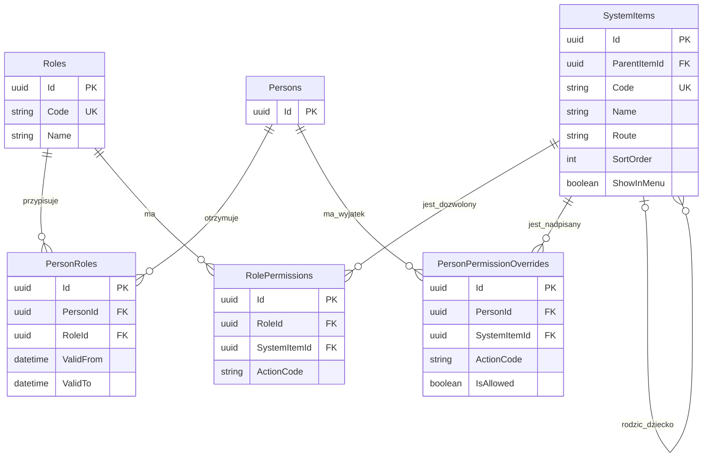
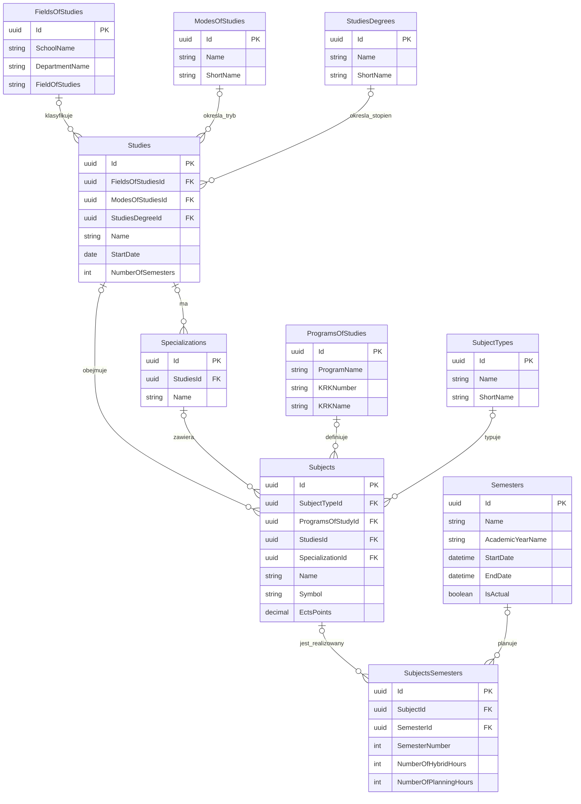
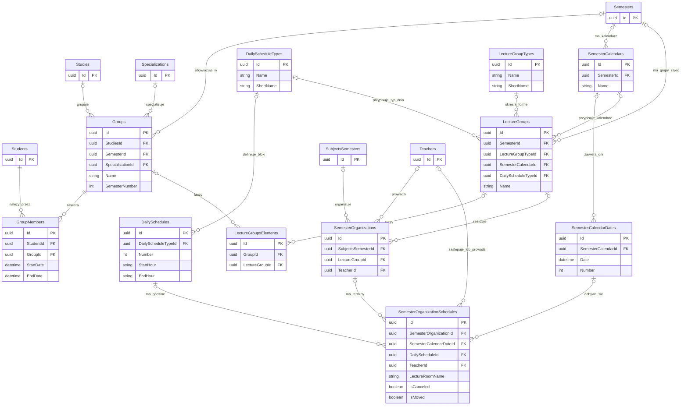
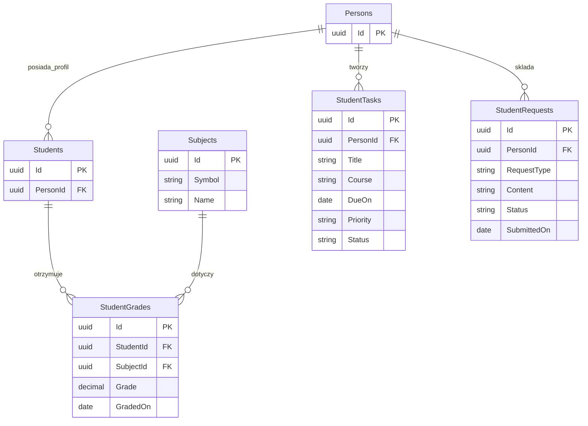
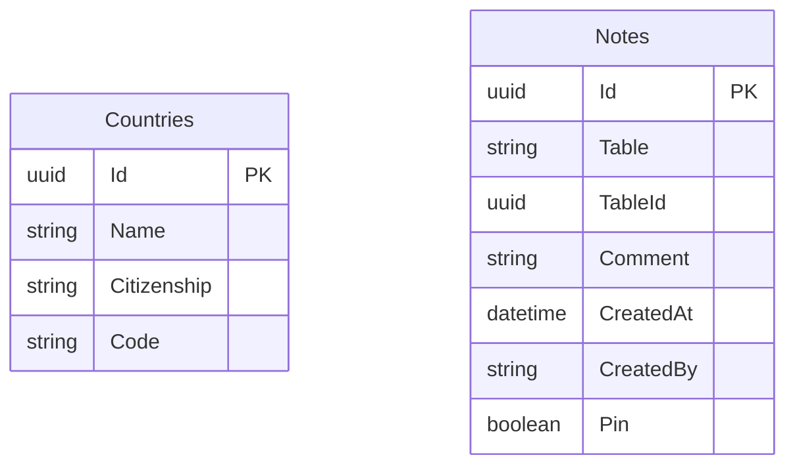

## 7. Diagramy ER bazy danych

Pełny model rozbito na domeny. Ta sama tabela może pojawić się na dwóch
diagramach jako punkt łączący domeny. Pokazano klucze i pola najważniejsze dla
zrozumienia relacji; powtarzalne pola techniczne (`IsActive`, `Timestamp`,
`OldId`) są opisane wcześniej.

Oznaczenia Mermaid:

- `||` — dokładnie jeden,
- `o|` — zero lub jeden,
- `o{` — zero lub wiele.

### 7.1. Osoby, konta i uwierzytelnianie

### 7.2. Role, menu i uprawnienia

### 7.3. Kierunki, studia, programy i przedmioty

### 7.4. Grupy i organizacja planu

### 7.5. Dane studenta używane w demonstracji

### 7.6. Tabele bez wymuszonej relacji

`Countries` nie ma w obecnym schemacie fizycznego klucza obcego z `Persons`.
Pola osoby przechowują jedynie kody kraju. `Notes` jest celowo relacją
polimorficzną: para `Table` + `TableId` wskazuje logicznie dowolny rekord, ale
SQLite nie może wymusić takiego klucza obcego.